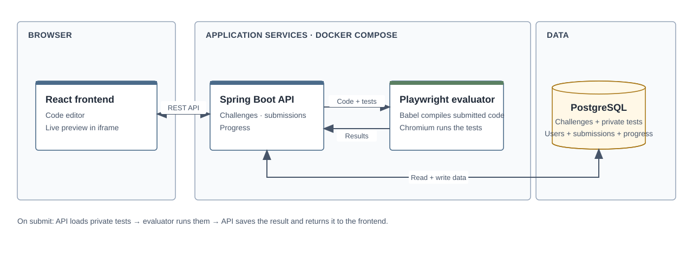

# BugForge system design

Open [bugforge-system-design.drawio](bugforge-system-design.drawio) in [diagrams.net](https://app.diagrams.net/) to edit the diagram.

The frontend sends requests to the API. The API reads challenge tests from PostgreSQL and asks the evaluator to run them. It saves the result and returns it to the frontend.
